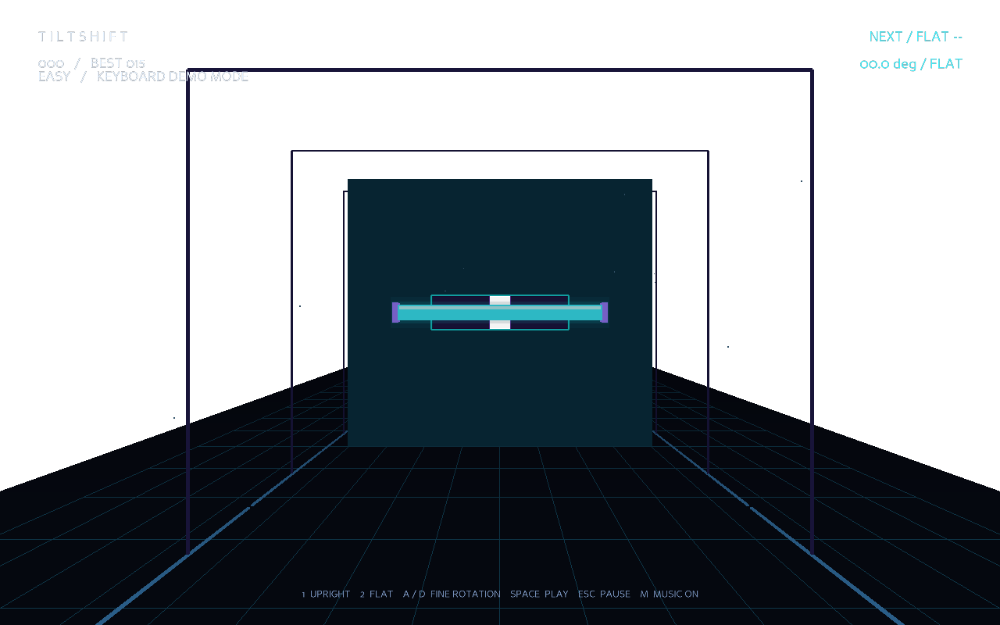
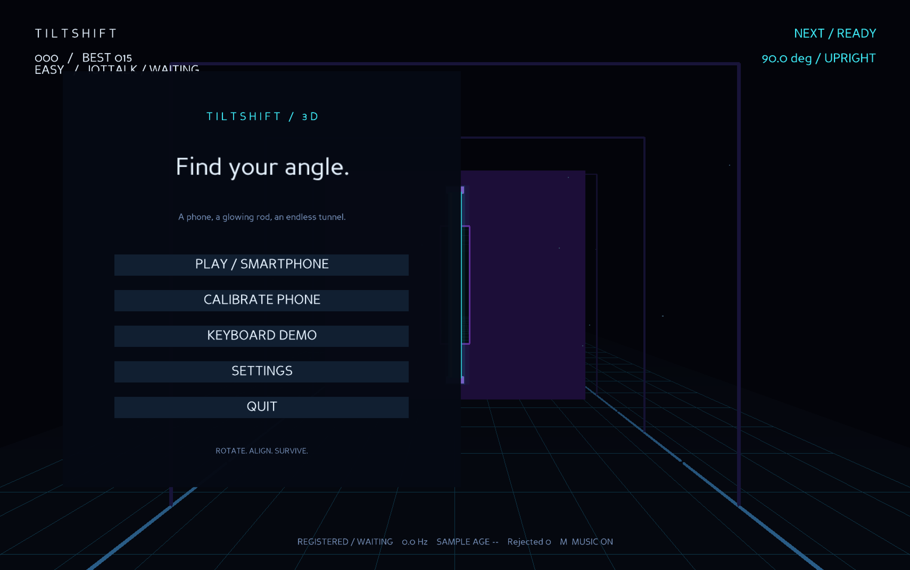
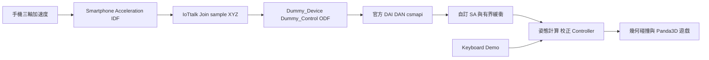
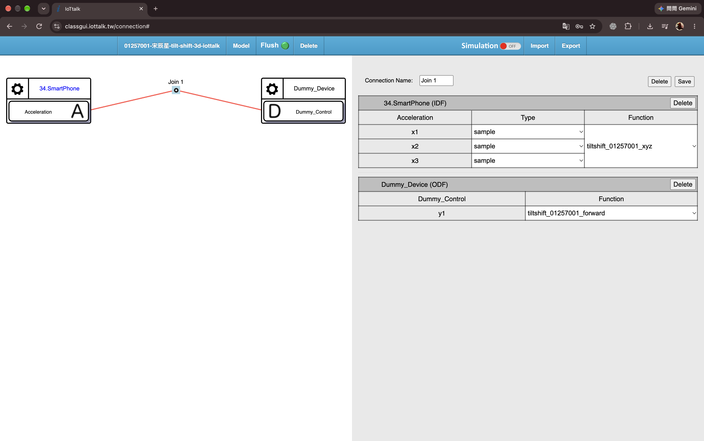

[▶ 觀看 TiltShift 3D Demo 影片](https://www.youtube.com/shorts/hfiL5N638h8)

# TiltShift 3D

**基於 IoTtalk 與智慧型手機姿態感測之 3D 障礙閃避遊戲**

將手機直立或平放，控制發光棍子的旋轉角度，對齊迎面而來的障礙牆缺口。每成功通過一面牆獲得 1 分，隨分數提升進入更快的難度階段。

作者：宋辰星｜國立臺灣海洋大學

課程主題：IoTtalk Dummy Device Creative Application

IoTtalk Project：`01257001-宋辰星-tilt-shift-3d-iottalk`

[繁體中文專題報告](docs/report/TiltShift3D_繁體中文技術報告.md) · [PDF 報告](docs/report/TiltShift3D_繁體中文技術報告.pdf) · [IoTtalk 接線指南](docs/IOTTALK_SETUP.md)

## 遊戲畫面



上圖為本機鍵盤示範模式的實際畫面；HUD 會明確顯示輸入模式。



## 功能

- **真實 3D 場景**：Panda3D 透視渲染、四塊實體組成的障礙牆與矩形缺口、隧道格線、霧化與發光效果。
- **手機姿態控制**：以含重力的三軸加速度估計螢幕傾斜程度，支援兩姿態校正與連續旋轉平滑。
- **幾何碰撞判定**：根據棍子旋轉後的投影寬高，以及牆厚與棍子深度的掃掠重疊區間判定，避免高速穿越漏判。
- **完整遊戲流程**：主選單、暫停、重新開始、最高分保存與 Easy／Normal／Hard 三階段難度。
- **聲音回饋**：BGM 循環播放，成功與碰撞分別播放 `success.mp3`、`fail.mp3`。
- **離線鍵盤示範**：無須手機或 IoTtalk 即可遊玩。
- **低頻輸入保護**：顯示實際接收頻率、樣本年齡與輸入品質，資料過期時自動暫停。

## 安裝

需要 Python 3.12 以上與可開啟桌面視窗的環境。開發環境已驗證 macOS Apple Silicon、Python 3.14.3、Panda3D 1.10.16。

```sh
git clone --recurse-submodules https://github.com/94SungLA/tilt-shift-3d.git
cd tilt-shift-3d
python3 -m venv .venv
.venv/bin/python -m pip install '.[dev]'
```

若已下載專案但 `iottalk-reference/` 內沒有官方 Python 程式，先在專案根目錄執行：

```sh
git submodule update --init --recursive
```

再建立虛擬環境並安裝。官方參考碼以 submodule 固定版本，完整下載需包含此子模組。套件安裝在 `.venv`，不需 Docker、資料庫或額外遊戲素材下載。

以下指令以 macOS 為例。Windows 請將 `.venv/bin/python` 改為 `.venv\Scripts\python.exe`；Windows 與 Python 3.12 尚未實機驗證。

## 啟動遊戲

### 鍵盤模式

```sh
.venv/bin/python run.py --mode keyboard
```

按 **Space** 或點選 **KEYBOARD DEMO** 開始，不需要連接 IoTtalk。

### 手機模式

```sh
.venv/bin/python run.py --mode iottalk
```

1. 手機開啟 [Smartphone 感測頁面](https://class.iottalk.tw/da/Smartphone/)，命名裝置並允許動作感測。保持頁面在前景、螢幕開啟。
2. 在課程 IoTtalk 專案選擇該次手機實例，並選擇已註冊的 `TiltShift-3D` 接收裝置。
3. 確認接線為 `Acceleration → Join → Dummy_Control`，三軸均設為 **sample**，**Flush 為綠色**、**Simulation 為 OFF**。
4. 遊戲中點選 **CALIBRATE PHONE**，依序收集舒適直立與平放姿態。需要新鮮、穩定的真實樣本才能完成。
5. 完成校正並確認 **LIVE** 後，點選 **PLAY / SMARTPHONE** 開始。

手機直立時棍子垂直；平放時棍子水平，中間傾斜程度對應連續角度。數學上取螢幕法向加速度的絕對值，因此螢幕朝上／朝下等價。更換手機時應重新校正或切換 profile。

校正設定與最高分保存在本機 `.local/`，不隨 Repository 上傳。手機重新開啟網頁可能產生新的實例；接收器重新註冊後也可能需要重新綁定，不能固定沿用截圖中的裝置名稱。

## 操作

| 按鍵 | 功能 |
|---|---|
| `1`／`2` | 鍵盤模式：直立／平放 |
| `A`／`D` 或左右方向鍵 | 鍵盤模式：微調角度 |
| `Space` | 開始、結束後重來或繼續暫停 |
| `Esc` | 暫停／繼續／返回選單 |
| `R` | 重新開始 |
| `M` | 背景音樂靜音／恢復，不影響成功與失敗音效 |

BGM 預設音量為 30%，成功與失敗音效為 70%。音檔缺失時會記錄警告並繼續遊戲。背景音樂在選單與遊戲中循環，關閉遊戲時停止。

## IoTtalk 架構



專案使用課程伺服器 `https://class.iottalk.tw`，沿用官方 Dummy Device v1 框架。`iottalk-reference/` 保留參考程式，專案接收回呼位於 `scripts/tiltshift_sa.py`，正式設定只有 `Dummy_Control`，沒有 `Dummy_Sensor` 發送器。

Python 接收端設定 `MQTT_broker=None`，使用官方 HTTP pull。`paho-mqtt` 是官方 DAI 的 import 相依套件，不代表本接收端採用 MQTT。所有網路操作在子程序中進行，接收資料經執行緒與鎖保護的 128 筆緩衝傳回主執行緒，避免阻塞渲染。



截圖中的手機為 `34.SmartPhone`，較早的真實資料紀錄使用 `92.SmartPhone`；兩者是不同時間的裝置實例。完整函式內容、註冊說明及步驟請見 [IoTtalk 設定指南](docs/IOTTALK_SETUP.md)。

### 輸入品質

| 狀態 | 判準與行為 |
|---|---|
| WAITING | 尚未收到合法樣本，不允許手機遊戲開始或收集校正 |
| LIVE | 最後有效接收距今不超過 0.65 秒 |
| DELAYED | 超過 0.65 秒且不超過 2 秒，保留方向並顯示延遲 |
| STALE | 超過 2 秒，正在遊玩時自動暫停 |

恢復 LIVE 後按 Space 繼續。**REGISTERED 表示註冊成功，不等於已收到手機資料。** HUD 的樣本年齡為本機接收後經過的時間，並非手機到筆電的單向網路延遲。平滑顯示不會增加感測資料筆數。

### 本機設定

需要變更設定時，可將 `.env.example` 複製為 `.env`。可調整伺服器、Device Model、ODF、接收裝置名稱、裝置識別碼、法向軸、payload 軸序與 profile。

```sh
cp .env.example .env
```

專案根目錄啟動器會載入 `.env`，但不覆蓋既有環境變數。預設使用 Z 軸為螢幕法向、XYZ 順序為 `0,1,2`。設定詳見 [.env.example](.env.example) 與 [校正說明](docs/CALIBRATION.md)。Project 密碼只用於課程網頁，不應寫入程式或公開設定。

## 測試與開發

```sh
# 不需視窗的邏輯與介面測試
.venv/bin/python -m pytest -q

# 最小 3D 渲染測試
.venv/bin/python scripts/smoke.py

# 完整圖形測試，約 14 秒後自動結束
.venv/bin/python run.py --mode keyboard --seed 7 --smoke

# 接收真實資料 30 秒，不啟動遊戲視窗
.venv/bin/python run.py --diagnose 30
```

**目前 pytest 結果：50 項通過。** 涵蓋姿態數學、校正、低頻輸入、有界緩衝與併發、幾何碰撞、掃掠判定、單次計分、排程、遊戲狀態、自訂 SA 介面與真實手機樣本回放。

本機圖形 smoke 已通過選單、鍵盤事件旋轉、成功過牆加分、碰撞、重啟、暫停／恢復與設定，也確認成功／失敗音效載入及觸發。測試會注入鍵盤事件並前移一面牆以驗證碰撞，不能當成真人手機遊戲紀錄。

既有真實接收紀錄包含 313 筆手機資料，滾動接收頻率中位數約 2.79 Hz，直立與平放資料支持所測手機使用 Z 作為螢幕法向。本機亦已查得有效校正設定。這些結果不等同於所有手機／網路均已測試；完整手機闖關、真人斷訊恢復與長時間效能仍需額外可追溯紀錄。詳見 [測試紀錄](docs/TESTING.md) 與 [專題報告](docs/report/TiltShift3D_繁體中文技術報告.md)。

可用 `--seed 7` 重複缺口序列，或以 `--speed 4 --interval 3.4` 覆寫速度與生成間隔。Settings 可恢復預設漸進難度。固定 seed 不保證不同輸入時間下得到相同分數。

## 專案結構

```text
tilt-shift-3d/
├── run.py                     # 中文／空白路徑適用的啟動器
├── pyproject.toml             # 套件與開發相依需求
├── bgm.mp3 / success.mp3 / fail.mp3
├── iottalk-reference/         # 官方框架 submodule，固定來源版本
├── scripts/                   # 自訂 SA 與最小渲染 smoke
├── src/tiltshift/
│   ├── game/                  # 幾何、掃掠碰撞、排程與狀態
│   ├── input/                 # 共用 Controller、樣本與緩衝
│   ├── orientation/           # 重力比例與時間感知平滑
│   ├── calibration/           # 校正參考值與樣本驗證
│   ├── iottalk/               # 官方接收器子程序管理
│   ├── ui/                    # Panda3D 場景、選單、HUD 與音訊
│   └── utils/                 # 本機 JSON 保存
├── tests/                     # pytest 與裁切的真實樣本 fixture
└── docs/                      # 說明文件、截圖、報告與 draw.io 原檔
```

## 常見問題

- **無法匯入套件**：確認使用 `.venv` 安裝相依套件，並從 Repository 根目錄執行 `run.py`。
- **已註冊但 WAITING**：檢查手機頁面前景與動作權限、正確裝置實例、三軸 sample、Join 函式及 Flush。
- **靜止時資料接近零**：確認不是 variant 變化量，且來源包含重力；校正預期大小約 9.8 m/s²。
- **校正不通過**：維持穩定姿態並重試，確認法向軸、單位與資料新鮮度。換手機應重新校正。
- **遊戲突然暫停**：可能是資料過期、視窗失去焦點或幀時間中斷；回到遊戲並在資料恢復後按 Space。
- **接收器重啟後沒有資料**：可能需重新綁定接收裝置。診斷與遊戲不要以同一裝置識別碼並行。
- **沒有音樂**：確認音檔位於專案根目錄，按 M 恢復 BGM，並檢查系統音量與輸出裝置。
- **沒有視窗**：遊戲需要本機桌面顯示環境；它不是瀏覽器遊戲。

## 文件

- [繁體中文專題報告](docs/report/TiltShift3D_繁體中文技術報告.md)／[PDF](docs/report/TiltShift3D_繁體中文技術報告.pdf)
- [可編輯 draw.io 系統架構圖](docs/report/assets/architecture.drawio)
- [IoTtalk 設定指南](docs/IOTTALK_SETUP.md)
- [系統架構與碰撞模型](docs/ARCHITECTURE.md)
- [手機校正原理](docs/CALIBRATION.md)
- [測試紀錄](docs/TESTING.md)
- [課堂展示流程](docs/DEMO.md)
- [英文作品簡介](docs/PROJECT_DESCRIPTION.md)
- [繳交檢查表](docs/SUBMISSION_CHECKLIST.md)

官方框架來源：[IoTtalk Dummy Device v1 Python](https://github.com/IoTtalk/Dummy_Device_IoTtalk_v1_py)。本作品延伸課程的 Smartphone → Dummy_Control 架構，使用確定性的重力姿態計算，未訓練手勢分類模型。
