# Architecture

```mermaid
flowchart LR
    Phone[Smartphone gravity-inclusive Acceleration] --> Join[University IoTtalk XYZ Join]
    Join --> Dummy[Dummy_Device / Dummy_Control]
    Dummy --> Official[Unmodified DAI + DAN + csmapi]
    Official --> SA[Project SA callback / child process]
    SA --> Pipe[Bounded OS pipe / drain thread]
    Pipe --> Buffer[Locked 128-sample ring buffer]
    Buffer --> Filter[Gravity alignment + calibration]
    Filter --> Controller[Shared controller / continuous angle]
    Keyboard[Keyboard demo] --> Controller
    Controller --> Game[Pure geometry and state machine]
    Game --> Renderer[Panda3D / main thread]
```

## Modules

- `game/core.py`: deterministic scheduling, difficulty, continuous depth crossing, geometry, score and states.
- `orientation/processing.py`: finite gravity measurement, frame-time-aware smoothing and mapping.
- `calibration/wizard.py`: stable real sample validation and profile data.
- `input/controller.py`: synchronized latest-value ring, frequency, age, keyboard and phone abstraction.
- `iottalk/receiver.py`: managed official DAI child and reader thread. All renderer objects stay on the main thread.
- `scripts/tiltshift_sa.py`: official custom-SA interface, `IDF_list=[]`, configurable ODF callback, registration event and source timestamps.
- `ui/app.py`, `ui/scene.py`: procedural solids, neon tunnel, menus, particles, bloom, HUD and calibration wizard.
- `utils/storage.py`: atomic local JSON writes; `.local/` ignored by Git.

The reference `DAI.py` takes a module argument, but splits it at the first dot. We therefore use the flat module `tiltshift_sa` through `PYTHONPATH`, not a dotted package. The child inherits the venv interpreter. Subprocess argument arrays preserve spaces and Chinese characters. No reference source changes are needed. Production uses official HTTP polling (0.1 seconds between calls); polling cannot increase the smartphone's own sample rate. Official DAN deduplicates by the server sample timestamp.

## Coordinates and geometry

Panda3D: X horizontal, Y forward/depth, Z vertical. Rod center `(0,0,0)`, camera `(0,-12,0)`, walls spawn at Y=32 and move toward negative Y. Rod length 3, in-plane thickness .22, depth .22; wall depth .55. Openings are .9 × 3.6 or 3.6 × .9. Each wall comprises four solid boxes with a real empty rectangle.

At angle θ, projected full width is `3|cos θ| + .22|sin θ|`; height is `3|sin θ| + .22|cos θ|`. Both must fit the corresponding opening with .025 total dimensional tolerance. The overlap slab extends ±(.55+.22)/2 along depth. Entry/exit fractions are solved for every movement, even when a wall crosses the entire slab in one update. Angular extrema are checked over the overlapped angle interval, including interior maxima; scoring occurs once after the trailing face clears the rod. The angle between render samples uses a linear trajectory model; physical collision never uses the stable pose label. This is a geometric model, not rigid-body dynamics.

Simulation uses steps no larger than 1/120 second; fixed seed repeats wall patterns. Default phases: easy <5 points, 4 units/s, spacing 3.4 s; normal <15, 5.5 units/s, 3 s; hard ≥15, 7 units/s, 2.6 s. Normal/hard alternate poses. Old obstacles accelerate with the current global speed. Minimum default arrival spacing at a phase change remains about 2.36 s, including an overlap duration under .2 s. Debug speed .5–12 and spacing ≥2.6 are configurable.

## Connection and shutdown

Registration and LIVE input are separate statuses. Local receive age >.65 seconds shows DELAYED; >2 seconds pauses and requires explicit resume after fresh input. Until the first valid sample, WAITING never permits smartphone gameplay or calibration. A render stall >.3 seconds also pauses. The bounded ring stores 128 samples; the render loop consumes only newly received samples. Transport exceptions are logged by the official client; malformed callback events are logged by the adapter.

Source timestamps are retained for diagnosis; only local monotonic receive age and receive frequency are reported. These are not network one-way latency measurements. No synchronized phone clock is available. The UI smoothing adds a response lag and does not recover missing samples.

Shutdown signals the child to deregister via official DAN, waits two seconds, then kills a hung child and joins the reader. The official control thread is confined to the child. A forced kill may leave a server device entry until its normal timeout. Only run one process for a given device ID.
