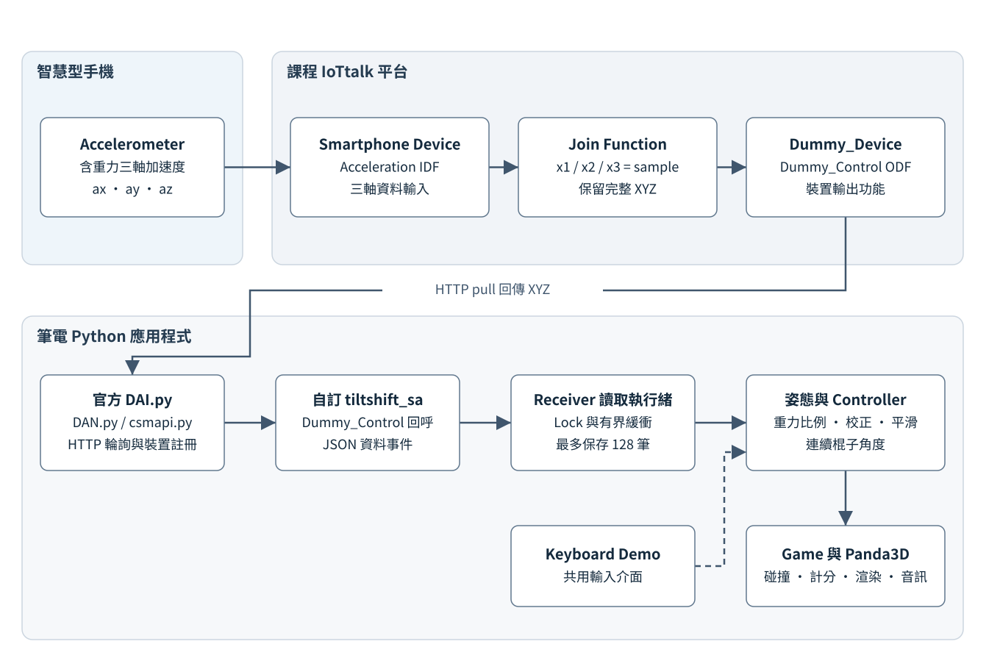
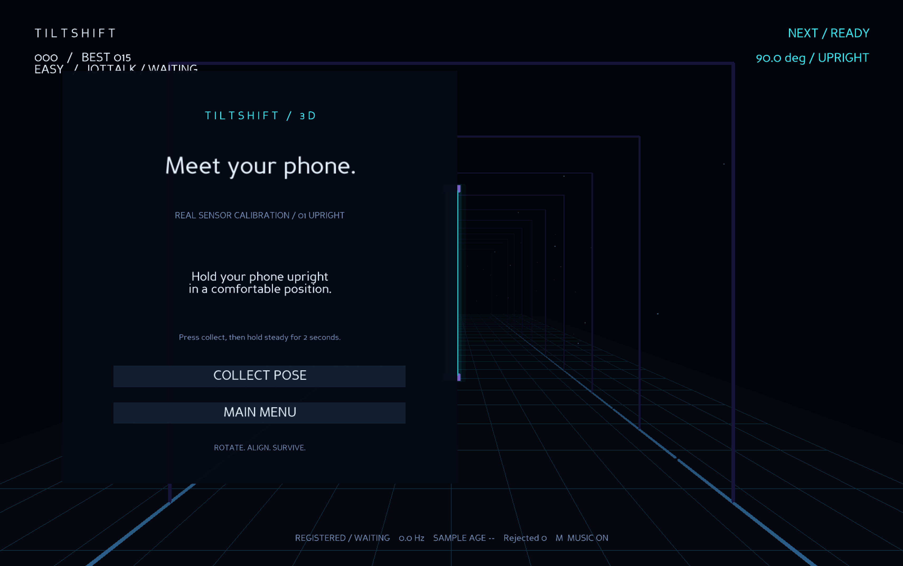
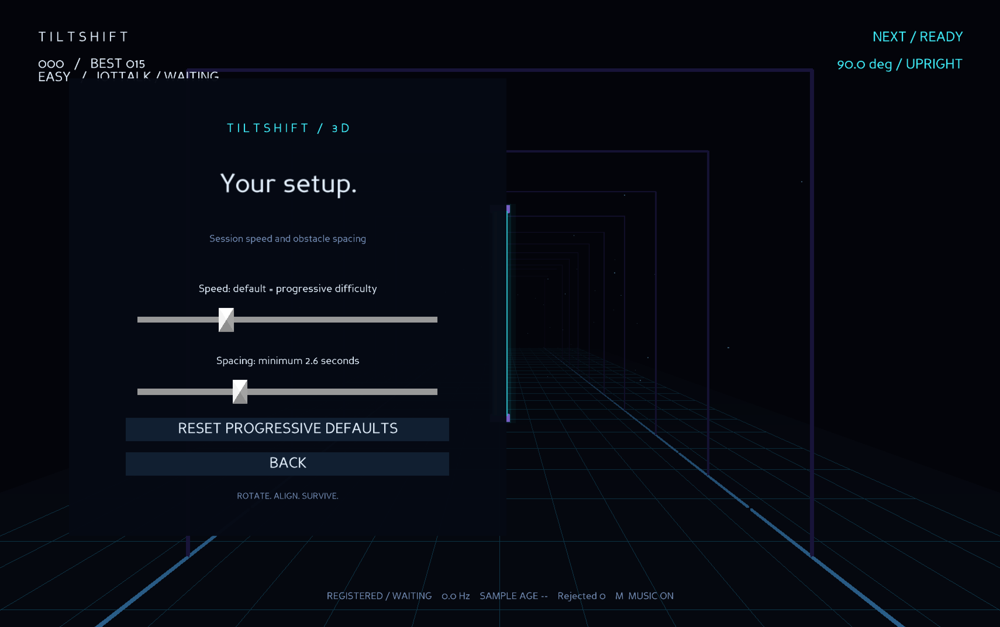

[▶ 觀看 TiltShift 3D Demo 影片](https://www.youtube.com/shorts/hfiL5N638h8)

# TiltShift 3D 專題技術報告

## 基於 IoTtalk 與智慧型手機姿態感測之 3D 障礙閃避遊戲

作者：宋辰星　學校：國立臺灣海洋大學

課程主題：IoTtalk Dummy Device Creative Application

IoTtalk Project：01257001-宋辰星-tilt-shift-3d-iottalk

報告日期：2026 年 10 月 22 日　專案版本：1.0.0

### 1 專題摘要

本專題將手機三軸加速度感測器轉換為遊戲控制器，透過 IoTtalk 將 Acceleration 經 Join Function 傳入 Dummy_Control，再由官方 Python 框架接收。遊戲以 Panda3D 建立透視隧道，玩家直立或平放手機，使發光棍子連續旋轉並對齊迎面牆壁的缺口。系統採重力對齊比值、兩姿態校正及時間感知平滑處理低頻輸入，以投影尺寸與掃掠式判定避免高速漏判。成果包含鍵盤示範、分級難度、計分、音效與斷訊暫停；本次 50 項測試通過，並查得真實手機資料與有效校正設定。完整手機闖關及斷訊恢復仍需補充可追溯紀錄。

關鍵詞：IoTtalk、Dummy_Control、Accelerometer、Panda3D、姿態校正、掃掠式碰撞判定。

### 報告範圍

本報告說明實際程式、資料流程、數學模型、課程架構對應及測試證據。查核對象為目前工作目錄，而非預期需求清單；Git 的 main 分支尚無 commit，無可引用的提交編號或提交時序。

閱讀順序：第 2 至 4 章為設計與 IoTtalk；第 5 至 8 章為姿態、校正與碰撞；第 9 至 12 章為遊戲、可靠性與測試；第 13 章為限制與結論。

## 2 研究動機與設計理念

### 2.1 將既有手機轉為自然互動裝置

一般筆電遊戲依賴鍵盤或滑鼠。本作品改以手機螢幕平面相對重力的傾斜程度控制遊戲，讓玩家透過「直立」與「平放」理解角色方向，不需另購微控制器、感測板或專用控制器。遊戲中的棍子固定在中央，玩家專注於旋轉與對齊，降低初次操作的學習負擔。

IoTtalk 負責跨裝置資料交換，Python 程式負責計算與呈現。此分工將手機的實體感測輸入連結到筆電上的互動應用，也保留課程要求的 Dummy Device 應用結構。（Lab 3 第 2 至 6 頁）（Lab 4 第 3 至 6 頁）

### 2.2 為何採用姿態而非快速手勢

實測接收頻率中位數約為 2.79 Hz，相鄰資料平均尺度約為 0.36 秒；這不適合依賴短促揮動或高頻軌跡的控制方式。系統因此選擇可持續維持的姿態，讓每筆資料仍能表達當下方向。濾波與插值僅改善顯示連續性，不會重建遺失的感測資訊。

本作品未訓練機器學習模型，也未使用 Gyroscope 進行姿態融合。Lab 4 的手勢辨識示意提供應用方向，但不代表本專案採用相同演算法。兩姿態校正的目的，是估計個人舒適握姿的參考值，而非訓練手勢分類器。（Lab 4 第 10 頁）

## 3 系統架構



圖 1　TiltShift 3D 系統架構，資料由手機感測器經課程伺服器送至筆電。網路接收、執行緒緩衝與畫面更新分離。

手機提供三軸資料；Join 保留 XYZ；Dummy_Control 作為輸出 Device Feature 接收。筆電子程序執行官方 DAI，由自訂 SA 送出 JSON 事件，讀取執行緒再交給有界緩衝區。主執行緒取出新資料、計算角度與碰撞，最後由 Panda3D 更新場景。鍵盤模式使用同一 Controller，但不產生虛構手機樣本。

## 4 IoTtalk 平台設定

### 4.1 平台元件與課程對應

| 元件 | 本專案實際設定 | 課程對應 |
|---|---|---|
| IoTtalk Server | https://class.iottalk.tw | Lab 3 的官方裝置註冊架構 |
| Smartphone | 圖 2 為 34.SmartPhone；既有資料紀錄使用 92.SmartPhone | Lab 4 手機感測資料輸入 |
| Acceleration IDF | 三欄 x1、x2、x3 對應 ax、ay、az | Lab 4 第 4、6 頁 |
| Dummy_Device | 筆電端裝置模型 | Lab 3 與 Lab 4 的 Dummy Device |
| Dummy_Control ODF | 唯一登錄的輸出功能 | Lab 4 第 2 至 5 頁 |
| Join Function | 三軸均為 sample，保留完整 XYZ | Lab 4 第 6 頁的多參數回傳 |

Lab 3 說明官方程式下載、虛擬環境、套件安裝及 SA 設定；Lab 4 延伸為 Smartphone → Acceleration → Dummy_Control。本專案沿用此資料方向，不另外架設 IoT 伺服器，也不以 Dummy_Sensor 隨機數當作正式手機輸入。

### 4.2 官方框架與自訂程式的職責

| 檔案 | 實際用途 |
|---|---|
| iottalk-reference/DAI.py | 載入 SA、建立 IDF／ODF 回呼表、設定 DAN profile、註冊並啟動輪詢；也保留官方 MQTT 分支 |
| iottalk-reference/SA.py | 官方範例設定與 Dummy_Sensor／Dummy_Control 範例；正式遊戲未載入此模組 |
| scripts/tiltshift_sa.py | 專案自訂 SA；設定伺服器、模型及 ODF，將接收資料轉成 JSON 事件 |
| iottalk-reference/DAN.py | 註冊、控制通道、RESUME／SUSPEND、pull／push 包裝，以及來源時間戳去重 |
| iottalk-reference/csmapi.py | 以 requests 實作 HTTP 註冊與讀寫，處理裝置工作階段驗證資訊 |
| iottalk-reference/Agent.py | 官方程序監控與重啟範例；本專案啟動流程未使用 |

正式 SA 設定 `IDF_list=[]`、`ODF_list=['Dummy_Control']`、`MQTT_broker=None`、`exec_interval=0.1`。因此 Python 接收端走官方 HTTP pull；安裝 paho-mqtt 是滿足官方 DAI 的 import 需求，不代表遊戲接收端使用 MQTT。手機網頁端的傳輸協定不能由此反推。

DAI 會把 SA 參數在第一個句點切開，故使用不含套件點號的 `tiltshift_sa`。Receiver 以子程序參數陣列啟動官方 DAI，並將 scripts 加入 PYTHONPATH，避免中文與空白路徑造成 shell 拆解問題。

### 4.3 Smartphone 到 Dummy_Control 的資料映射

依目前設定文件與已保存畫面，Join 的 Acceleration 函式為 `tiltshift_01257001_xyz`，回傳三個浮點數；Dummy_Control 的函式 `tiltshift_01257001_forward` 取出第一個輸入，不先轉為姿態標籤。

```python
# Acceleration 函式
def run(*args):
    return [float(args[0]), float(args[1]), float(args[2])]

# Dummy_Control 函式
def run(*args):
    return args[0]
```

三軸 Type 必須設為 sample。既有實測紀錄指出，初始 variant 設定產生接近零的變化量；切換 sample 並使 Flush 為綠色後，才取得可用於重力方向估計的資料。本項敘述以已留存紀錄為依據，不宣稱本次報告製作時重新登入或重新設定伺服器。


圖 2　 IoTtalk 接線與 Join 設定截圖。輸入端為 34.SmartPhone 的 Acceleration，經 Join 1 連至 Dummy_Device 的 Dummy_Control；x1、x2、x3 均設為 sample，輸入與輸出函式分別為 tiltshift_01257001_xyz 與 tiltshift_01257001_forward。畫面顯示 Flush 為綠色、Simulation 為 OFF。

### 4.4 註冊與執行方式

建議由 Repository 根目錄執行下列指令。第一個指令啟動手機模式；第二個僅用於觀察真實資料。兩者不要以相同裝置識別碼同時執行。

```sh
.venv/bin/python run.py --mode iottalk
.venv/bin/python run.py --diagnose 30
```

Receiver 內部的等效子程序為「目前虛擬環境 Python、官方 DAI.py、tiltshift_sa」三段參數。首次產生的裝置識別碼儲存在本機，後續重用；註冊成功事件與資料 LIVE 狀態分開呈現。關閉時官方 DAN 會嘗試 deregister，重新啟動後可能需要在 GUI 重選接收裝置並確認 Flush。

## 5 手機姿態辨識原理

### 5.1 從三軸加速度取得重力對齊程度

令 ax、ay、az 為手機座標系的加速度，單位預期為 m/s²。在靜止或緩慢移動時，含重力加速度主要反映重力方向。程式先計算三軸向量大小，再取螢幕法向軸的絕對分量比例；預設法向軸為 Z，可由環境設定修改。

<!-- equation:magnitude -->
$$m = \sqrt{a_x^2+a_y^2+a_z^2}$$

<!-- equation:alignment -->
$$q = \frac{|a_z|}{\sqrt{a_x^2+a_y^2+a_z^2}}$$

直立時，重力大致位於螢幕平面內，因此 q 接近 0；平放時，重力大致平行螢幕法向，因此 q 接近 1。取絕對值使螢幕朝上與朝下在數學上等價；直立時改變朝向或在螢幕平面內轉成橫向，也不會改變此比例的理想值。

此數值是單一傾斜量測，不是包含 yaw、pitch、roll 的完整姿態解。它在理想靜態條件下相當於傾角的三角函數比例，但程式沒有計算反三角函數，而是將比例依校正範圍線性映射為遊戲角度。

### 5.2 資料檢查與雙層平滑

alignment 拒絕布林值、非數值、NaN、無限值及大小不在 0.5 至 40 的向量，避免除以零與明顯錯誤資料。正式校正另採較嚴格的重力範圍。GravityFilter 濾波的是已正規化的 q，不是完整三維重力向量；新資料的時間間距決定濾波係數，超過 2 秒則直接重設為新量測。

<!-- equation:smoothing -->
$$x_{new}=x_{old}+(x_{target}-x_{old})(1-e^{-\Delta t/\tau})$$

感測比例濾波的 τ 為 0.22 秒；畫面棍子角度另以 τ=0.14 秒平滑。兩者都使用實際時間間距，降低不同更新率造成的響應差異，但仍會增加反應延遲，不能把平滑後的每幀畫面當成新增感測樣本。

### 5.3 連續角度與穩定狀態分離

Controller 的 target 為連續目標角度，angle 為平滑後用於渲染與碰撞的角度。target 大於 65°為 UPRIGHT，小於 25°為 FLAT，其餘為 TILTING；候選分類維持至少 0.3 秒才更新 confirmed。這是持續時間確認，不是額外的施密特觸發式雙閾值遲滯。遊戲不以 confirmed 標籤代替幾何判定。

## 6 兩姿態校正與設定保存

### 6.1 校正流程

玩家選擇 CALIBRATE PHONE，程式切換至真實 IoTtalk 輸入。第一步維持舒適直立姿態並按 COLLECT POSE；第二步將螢幕平放朝上或朝下並再次採樣。只有按下收集後的新接收樣本才參與估計，沒有新鮮資料時不開始收集。鍵盤示範可直接遊玩，不以假資料進行手機校正。

| 驗證項目 | stable_reference 或校正流程的條件 |
|---|---|
| 數量與時間 | 至少 8 筆，首末樣本跨度至少 1.4 秒 |
| 收集窗口 | 至少等待 2.2 秒；不足 8 筆時延長至 4.5 秒再檢查 |
| 資料新鮮度 | 最後樣本年齡不超過 0.65 秒；第一筆不超過 6 秒 |
| 姿態穩定度 | q 的母體標準差不超過 0.065 |
| 重力大小 | 每筆向量大小嚴格大於 5、嚴格小於 15 m/s² |
| 大小穩定度 | 向量大小的母體標準差不超過 1.2 m/s² |
| 姿態分離度 | flat − upright 至少 0.35，兩值均須在 0 至 1 |

成功通過後，各姿態的 q 平均值分別作為 upright 參考 u 與 flat 參考 f。程式使用下式求目標角度，將直立映射為 90°、平放映射為 0°，超出校正範圍時以 clip 限制在端點。

<!-- equation:mapping -->
$$\theta_{target}=90^\circ\left[1-\operatorname{clip}\left(\frac{q-u}{f-u},0,1\right)\right]$$



圖 3　手機校正第一階段，畫面提示玩家維持舒適的直立姿態，並提供 COLLECT POSE 按鈕。此截圖由使用者於 2026 年 10 月 22 日提供；當時顯示 REGISTERED／WAITING、0.0 Hz，代表裝置已註冊但尚未收到有效樣本，不能單憑此畫面判定校正已完成。

## 7 3D 場景與棍子幾何

### 7.1 引擎與渲染方法

實際程式直接繼承 Panda3D 的 ShowBase，未使用 Ursina。立方體由 GeomVertexData、GeomVertexWriter 與 GeomTriangles 建立頂點、法向量與三角形；場景以透視相機觀察真正的 3D 實體，並非將整個遊戲畫成平面圖片。

Panda3D 的 X 為水平方向、Y 為深度方向、Z 為垂直方向。棍子位於原點，相機位於 (0,−12,0)，朝 (0,16,0) 觀察；視角為 62°，近遠裁切距離為 0.1 與 110。牆壁從 Y=32 向負 Y 接近。棍子的長邊原本沿 X，程式以 setR(−angle) 在 XZ 平面旋轉，故 angle=0° 水平、90°垂直。

| 幾何項目 | 碰撞模型的實際尺寸 |
|---|---|
| 棍子長度 L | 3.0 |
| 棍子平面厚度 T | 0.22 |
| 棍子深度 Dr | 0.22 |
| 障礙牆深度 Dw | 0.55 |
| 垂直缺口 | 寬 0.9、高 3.6 |
| 水平缺口 | 寬 3.6、高 0.9 |
| 尺寸容許值 ε | 全寬／全高各加 0.025，不是兩側各加 0.025 |

### 7.2 真實缺口與視覺效果

每面牆由左右側塊與上下蓋塊共四個實體組成，中央矩形區域保持空白，因此缺口具有幾何意義。LineSegs 網格、隧道框架、Fog、CommonFilters Bloom，以及棍子的透明 halo 建立深度與發光效果。通過與失敗事件另產生短暫粒子。

### 7.3 旋轉後的投影尺寸

棍子於 XZ 平面旋轉 θ 後，完整投影寬度與高度如下。fits 同時比較兩個尺寸，並非只比較「橫／直」標籤。

<!-- equation:extentw -->
$$W(\theta)=L|\cos\theta|+T|\sin\theta|$$

<!-- equation:extenth -->
$$H(\theta)=L|\sin\theta|+T|\cos\theta|$$

通過條件為 W(θ)≤缺口寬+ε 且 H(θ)≤缺口高+ε。以垂直缺口為例，θ=90° 時寬高為 (0.22,3.0)，可以通過；θ=0° 時寬度為 3.0，會碰撞；θ=45° 時兩投影約為 2.277，亦無法通過窄邊。

模型採尺寸表中的核心棍子；端帽、highlight 與透明 halo 是裝飾，不列入碰撞。因此「物理尺寸」是明確定義的邏輯模型，不是所有可見發光像素的聯集。

## 8 掃掠式碰撞判定與單次計分

### 8.1 牆厚與棍子深度形成重疊區間

若只在某一幀檢查牆中心是否接近原點，快速牆壁可能直接越過判定面。crossing 使用前後深度位置，計算牆與棍子在深度方向相交的時間比例。重疊半寬為兩者深度相加的一半。

<!-- equation:slab -->
$$h=\frac{D_w+D_r}{2}=0.385$$

設牆中心由 y0 移至 y1，且 d=y0−y1>0。程式將進出比例限制在 [0,1]，並在該角度區間檢查是否始終能容納於缺口。

<!-- equation:enter -->
$$t_{in}=\operatorname{clip}\left(\frac{y_0-h}{d},0,1\right)$$

<!-- equation:leave -->
$$t_{out}=\operatorname{clip}\left(\frac{y_0+h}{d},0,1\right)$$

角度依前後渲染角度在線性時間模型中插值。swept_fits 不只驗證區間兩端，也加入每 90°週期內投影函數的極值候選，其中 α=atan2(T,L)；這可偵測「起終角度能通過，但中間旋轉掃到牆」的情形。

### 8.2 實際判定次序

1. Game.update 將每次時間增量切成不超過 1/120 秒的小步，更新深度與中間角度。
2. 若牆與棍子不曾進入深度重疊區間，回傳 none。
3. 若重疊期間任何投影尺寸不符，回傳 collision，遊戲進入 over。
4. 若牆中心已越過 −h，且 scored 尚為 False，設為 True 並回傳 pass。
5. Game 收到 pass 後加 1 分；之後同一牆不會再次計分。

測試涵蓋從 Y=15 直接掃到 −15、錯誤方向、中間角度、牆內轉動與單次計分。掃掠計算解決的是目前直線深度運動與角度插值模型的漏判，並非通用連續剛體物理引擎。

### 8.3 模型適用範圍

玩家中心固定、牆洞置中且只繞深度軸旋轉，因此以投影包圍尺寸即可決定矩形能否完全置於缺口。程式沒有側向移動、任意軸翻轉或彎曲棍子的碰撞處理。若將來增加偏移缺口、三維姿態或非矩形輪廓，必須擴充模型，而不能直接沿用目前公式。

## 9 遊戲難度 計分與狀態管理

### 9.1 障礙排程與難度

| 階段 | 分數範圍 | 速度 | 生成間隔 | 缺口模式 |
|---|---|---|---|---|
| EASY | 0 至 4 | 4.0 單位／秒 | 3.4 秒 | 偽隨機垂直／水平 |
| NORMAL | 5 至 14 | 5.5 單位／秒 | 3.0 秒 | 相對上一牆交替 |
| HARD | 15 以上 | 7.0 單位／秒 | 2.6 秒 | 相對上一牆交替 |

初始牆距為 32，若整段維持 Easy 速度，接近重疊區約需 (32−0.385)/4≈7.90 秒。難度依當前分數變更，場上既有牆亦使用新的全域速度；因此生成間隔不能直接等同於難度切換時的固定抵達間隔。程式未實作對所有調整參數的「絕不可能出現困難組合」形式證明。

固定 seed 會重建 Random 並重複缺口序列；這不保證在不同人類操作、掉幀或輸入時間下得到相同分數。命令列允許速度 0.5 至 12、間隔至少 2.6 秒；Settings 滑桿速度範圍為 2 至 9、間隔 2.6 至 5 秒。這些除錯設定不會寫入持久設定檔。

### 9.2 狀態與操作

Game 核心處理 menu、playing、paused、over；UI 另使用 settings、calibration。只有 playing 才更新牆壁與計分。Space 可開始、在結束後重來或繼續暫停；Esc 可暫停、繼續或回選單；R 重新開始。手機模式開始前必須有有效校正與 LIVE 輸入，恢復暫停也需 LIVE。

| 按鍵 | 鍵盤示範功能 |
|---|---|
| 1／2 | 目標角度 90°／0° |
| A／D 或左右鍵 | 每次按鍵事件調整 8°，限制於 0°至 90° |
| Space／Esc／R | 開始或繼續／暫停或返回／重來 |
| M | 切換 BGM 音量，不控制成功與失敗音效 |

best.json 只在 Game Over 出現新高分時更新；圖形 smoke 不寫入最高分。本次查得本機最高分為 15，但檔案未保存輸入模式與每局歷史，不能據此斷言是手機模式達成。


圖 4　遊戲主選單，提供手機遊玩、手機校正、鍵盤示範、設定與離開功能。背景保留棍子、障礙缺口及隧道景深；HUD 顯示目前方向與輸入狀態。此截圖當時為 IoTtalk WAITING 狀態。



圖 5　設定畫面提供移動速度與障礙生成間距滑桿，並可恢復漸進難度預設值。畫面中的「minimum 2.6 seconds」對應間距滑桿下限；設定只影響當次執行，不代表已儲存為持久化設定。

### 9.3 聲音與事件回饋

OpenAL 載入 bgm.mp3 並以 30% 音量循環；成功 pass 事件播放 success.mp3，collision 播放 fail.mp3，兩音效設為不循環、70% 音量。畫面處理的是該次更新回傳事件，並非每幀因為仍然靠近牆就重播。缺少音檔時寫入警告並繼續遊戲；關閉會停止已載入的聲音。

## 10 低頻輸入與執行緒安全

### 10.1 有界緩衝與時間資訊

LatestBuffer 以 Lock 保護 deque，最多保存 128 筆 Sample；每筆包含 xyz、本機 monotonic 接收時間 received，以及可選的來源時間 source_time。輸入支援 [ax,ay,az] 與外包一層的 [[ax,ay,az]]，依設定軸序取值。它拒絕格式錯誤及本機時間非遞增資料，並累計 rejected。

Controller 在主執行緒中處理 received 晚於 last 的樣本。即使某幀沒有新樣本，畫面仍向既有 target 平滑靠近，但 buffer 不會為此增加資料筆數。容量有限意味著消費者長時間落後時會捨棄最舊樣本，避免記憶體無限成長。

### 10.2 連線品質與安全暫停

| 狀態 | 實際判準 | 遊戲行為 |
|---|---|---|
| WAITING | 尚無合法樣本 | 不允許手機開始或校正收集 |
| LIVE | 最後本機接收年齡 ≤0.65 秒 | 可開始或恢復 |
| DELAYED | 年齡 >0.65 且 ≤2 秒 | 顯示延遲，保留角度，尚不自動暫停 |
| STALE | 年齡 >2 秒 | 若正在遊玩則暫停，恢復需新資料與手動操作 |

品質中的頻率，使用近 5 秒有效樣本，以「樣本數−1」除以首末接收時間差。若不足兩筆則為 0。HUD 的 SAMPLE AGE 是本機距離最後一次接收的時間；來源時間只被保留，未進行跨裝置時鐘同步，也沒有計算單向網路延遲。

REGISTERING、REGISTERED、STOPPED 為程序或註冊狀態，與上述感測品質分開。REGISTERED 不保證持續收到手機資料；大量不合理樣本也可能使有效輸入轉為 STALE。

### 10.3 主執行緒隔離與關閉

網路輪詢位於官方 DAI 子程序；父程序的一個 daemon 讀取執行緒解析 JSON，透過 buffer 交接，沒有從網路回呼直接修改 Panda3D 場景。一般失去視窗焦點或幀時間超過 0.3 秒也會暫停；smoke 模式特別排除這兩種干擾，以利可重現的圖形檢查。

關閉時 Receiver 發送 SIGTERM，自訂 SA 呼叫官方 DAN.deregister；父程序等待 2 秒，逾時則 kill 並等待結束，再有限等待讀取執行緒。官方 HTTP pull 的 timeout 為 10 秒，deregister 則未明定 timeout，因此程序隔離與強制結束是防止畫面卡住的實際界線。

## 11 開發環境與自動測試

### 11.1 宣告需求與本次環境

| 項目 | pyproject.toml 宣告 | 本次虛擬環境查得 |
|---|---|---|
| Python | ≥3.12 | 3.14.3 |
| Panda3D | ≥1.10.16 且 <1.11 | 1.10.16 |
| requests | ≥2.31 且 <3 | 2.34.2 |
| paho-mqtt | ~=2.1.0 | 2.1.0 |
| pytest | 開發相依 ≥8 | 9.1.1 |
| 專案版本 | 1.0.0 | 1.0.0 |

本次環境為 macOS Apple Silicon；既有圖形輸出使用 CocoaGraphicsPipe。宣告可使用 Python 3.12 不等於已在 3.12 測試。Ursina 不在相依項目內，不能宣稱其已通過相容性測試。

### 11.2 pytest 結果與覆蓋範圍

本次由 Repository 根目錄重跑 `.venv/bin/python -m pytest -q`，結果為 **50 passed**。以 test_core.py、test_adapter.py 與真實資料 fixture 為依據，覆蓋範圍如下。

| 類別 | 主要驗證內容 |
|---|---|
| 姿態數學 | 零向量、非有限值、指定法向軸、朝上／朝下、平面內旋轉與中間角度 |
| 校正 | 樣本量、新鮮度、穩定度、單位範圍及兩姿態分離 |
| 輸入與併發 | 4 Hz 合成時間序列、延遲／過期、128 筆上限、同時讀寫與無序時間拒絕 |
| 幾何與計分 | 缺口方向、中間角度、跨整個深度區間、牆內轉動及每牆只計一次 |
| 遊戲邏輯 | 難度邊界、暫停／恢復／結束／重啟、固定 seed 排程與成功遊戲 |
| SA 與保存 | 自訂 ODF 名稱映射、事件欄位、IDF 空列表、JSON 保存及損壞檔案回退 |
| 真實樣本回放 | 92.SmartPhone 裁切直立／平放資料可通過參考值檢查與端點角度映射 |

SA 自動測試使用替身 DAN，驗證的是介面契約，不是線上伺服器。真實 fixture 保留實際 XYZ 與來源時間，但回放測試重新建立相對時間，因此不能作為「當下 LIVE 校正」的證據，也不代表 50 項測試全部使用實體手機。

### 11.3 圖形與音效測試

本次重跑 `run.py --mode keyboard --seed 7 --smoke`，檢查選單、按鍵旋轉、過牆加分、碰撞、重新開始、暫停／繼續與設定。此流程以鍵盤事件驅動，並將一面牆前移以加速驗證碰撞；不是人工手機闖關紀錄。測試日誌與結果列於第 12 章，沒有量測長時間 FPS 或端到端延遲。

## 12 實際成果與證據界線


圖 6　本機圖形 smoke 的真實畫面。HUD 明確標示 KEYBOARD DEMO MODE；棍子、洞口、背景格線與隧道均有透視深度。此截圖不作為手機操作的證明。

### 12.1 真實接收與校正設定

查核 .local/phone-check.log 可解析出 313 筆手機來源資料，來源時間自 2026 年 10 月 22 日 04:48:12 至 04:50:04（臺北時間）。日誌所列近 5 秒接收頻率的中位數為 2.7896 Hz；這是滾動頻率中位數，不是以整段起終時間推算出的總體平均。

| 觀察項目 | 已有證據 |
|---|---|
| 直立代表值 | (−0.2, −9.8, 0.6) m/s²，Z 比例約 0.061 |
| 平放代表值 | (−0.2, −0.2, −9.7) m/s²，Z 比例約 0.9996 |
| 全段向量大小 | 約 5.63 至 10.07 m/s²，包含轉換時的動作 |
| 全段 Z 對齊比例 | 約 0.0404 至 0.9997 |
| 校正結果檔 | u 約 0.0890、f 約 0.9961，存在且可驗證 |
| 最高分結果檔 | 15 分；未附輸入模式與逐局紀錄 |

這些資料支持所測手機以 Z 作為螢幕法向，並確認官方接收路徑曾傳遞真實樣本。它們不涵蓋所有手機型號、所有螢幕方向或不同網路環境。

### 12.2 最新圖形測試紀錄

本次圖形測試正常結束，日誌依序記錄 success 與 fail 事件，最後輸出：

```text
GRAPHICAL SMOKE PASS: menu, keyboard rotation, pass + score,
collision, restart, pause/resume, settings
```

上述結果對應原始單行日誌，僅為版面換行。成功與失敗音效皆已載入並觸發。MP3 解碼器的估計長度可能伴隨時間戳警告；這不等於已量測音效播放延遲或主觀音量品質。

## 13 功能完成度 限制與結論

### 13.1 已完成與仍待補充

| 項目 | 可支持的完成程度 |
|---|---|
| 3D 玩法與幾何碰撞 | 已實作，pytest 與本機圖形 smoke 通過 |
| 官方 IoTtalk 接收端 | 已實作，有既有註冊與真實資料日誌 |
| 兩姿態校正 | 演算法與 UI 已實作，目前存在有效保存設定 |
| BGM 與成功失敗音效 | 已實作，本機 smoke 載入並觸發 |
| 低頻品質與安全暫停 | 已實作；時間判準有測試，真人斷訊恢復流程未有完整紀錄 |
| 手機控制完整闖關 | 本機有最高分，但缺乏輸入模式與連續操作證據，仍待補錄 |
| 實體朝上與朝下比較 | 數學等價已有測試；成對實體操作證據仍不足 |
| 跨平台與效能 | 未完成 Windows、Python 3.12、多手機與長時間 FPS 基準測試 |

### 13.2 實作界線與改進方向

現有系統不包含多人連線、線上排行榜、模型訓練、陀螺儀融合、完整三維姿態重建或自訂後端。設定滑桿僅作用於當次程序，沒有音量滑桿或全域音效靜音；M 僅切換 BGM。已載入音檔缺失時會回退，但未建立音訊品質或全裝置錯誤矩陣。

目前穩定分類使用 dwell，並非完整遲滯設計；感測器緩衝依本機接收時間去重與排序，而來源時間仍依賴官方 DAN 行為。Receiver 的外部子程序若意外停止，status 會轉為 STOPPED，但 start 在已有 process 物件時直接返回，尚未實作父程序級自動重建；因此不能宣稱任意崩潰都能自動復原。

未來可補上具明確輸入模式與時間戳的逐局紀錄、感測／渲染延遲量測、手機斷訊復原實驗、更多校正品質指標，以及接收器程序故障後的重建機制。視覺端帽與核心碰撞尺寸的差異，也可透過統一模型或明確調整容許值改善。

### 13.3 結論

TiltShift 3D 已將課程 Dummy_Control 接收架構整合為可執行的 3D 遊戲，以單一重力對齊量測建立自然姿態控制。其工程重點在於保留官方 IoTtalk 框架、將網路與渲染隔離、讓低頻輸入可見且可暫停，以及以投影幾何與掃掠區間處理碰撞。現有證據足以支持程式功能、真實感測接收與保存校正設定；完整手機闖關與跨環境品質仍應透過額外可追溯實驗補足。
